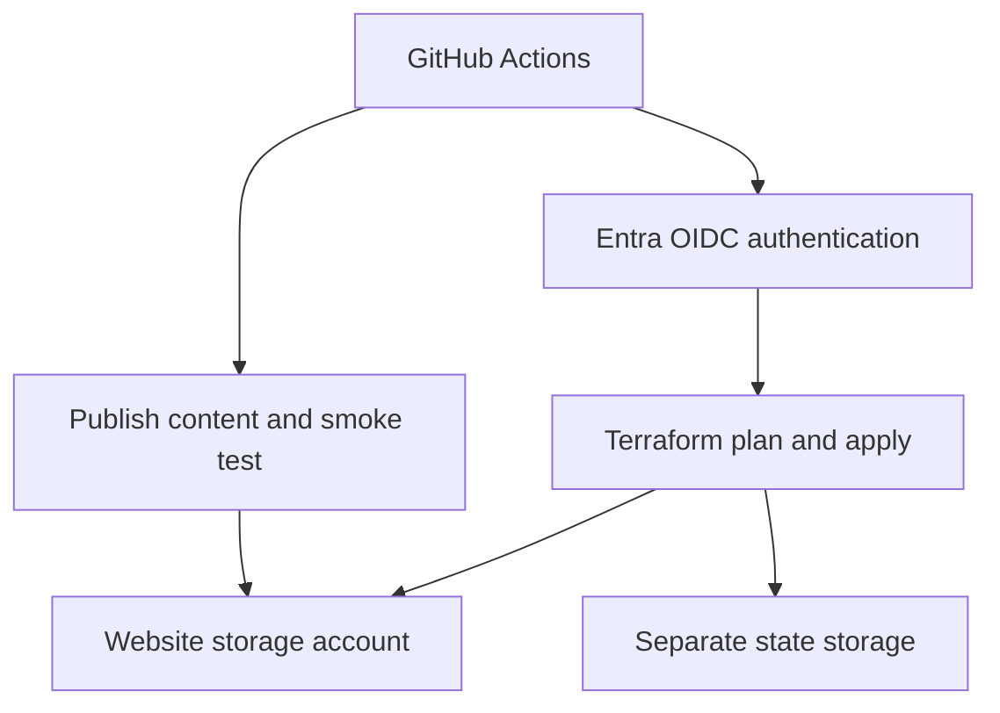

# Azure platform delivery lab

A personal Azure lab by **Rakesh Goriga** demonstrating infrastructure as code, federated CI/CD authentication, and an observable deployment path.

## Problem

Make a small website reproducible: provision the hosting infrastructure, authenticate a deployment without a long-lived client secret, publish content, and check that the expected page is served.

## Implemented scope

| Concern | Implementation |
| --- | --- |
| Hosting | Azure Storage static website with an index and 404 page |
| Infrastructure | Terraform with the AzureRM provider |
| State | Separate Azure Storage account and a Blob container |
| CI | Formatting and Terraform validation on pushes and pull requests |
| Deployment | Manually dispatched plan, apply, or destroy on the main branch |
| Identity | GitHub OIDC federation to an Entra application, bound to the dev environment |
| Verification | HTTP request followed by a check for expected page content |
| Coordination | GitHub Actions concurrency and Terraform state locking |

## Architecture

## Deployment sequence

1. Bootstrap the resource groups, state backend, deployment identity, federation, and role assignments.
2. Validate Terraform formatting and configuration.
3. Select plan, apply, or destroy through the deployment workflow.
4. Initialize remote state and create a saved Terraform plan.
5. For apply or destroy, execute the plan created in that same run.
6. After apply, upload the static content and verify both HTTP success and expected page content.

A plan-only run is a preview. It does not approve the plan generated by a subsequent apply run.

## Why these choices

**Separate state and application storage.** Application teardown should not remove the backend required to manage and destroy infrastructure.

**Federated identity.** OIDC avoids storing an Azure client secret in GitHub. Access still depends on correct trust configuration, environment restrictions, and scoped role assignments.

**Manual deployment.** Explicit plan/apply/destroy controls make the first lab easier to inspect. This is not a fully automated production release platform.

**Content smoke test.** An HTTP response alone does not prove that the intended page was published; the workflow also checks for a known string.

**Two access planes.** Resource management and Blob data access need different permissions. A successful sign-in does not imply access to Terraform state.

## Evidence

On **October 4, 2026**, the deployment workflow completed successfully, including initialization and validation, plan, saved-plan apply, publishing, and the content smoke test. The corresponding Terraform validation workflow also passed.

This records a successful lab deployment at that time. It does not assert that the website is continuously monitored or currently online. Workflow evidence is retained in the private source repository.

## Boundaries and tradeoffs

- This lab uses static hosting; it does not implement AKS, a database, an API, a CDN, or a service mesh.
- The static website endpoint serves public demo content, even though ordinary Blob public access is disabled.
- State and uploads use Entra authentication. The static website Terraform provider path uses management/key authentication.
- Bootstrap is a one-time setup script and is not fully idempotent; rerunning can create an additional application identity.
- The workflow currently uses version tags for actions. Commit SHA pinning and a separate post-plan approval gate are follow-up improvements.
- A committed provider lock file is a follow-up improvement for repeatable provider selection.
- The source repository remains private; no cloud account IDs or credential values are included in this case study.

## Next milestones

- Python operational tooling with meaningful tests and clear failure behavior.
- A containerized API and documented deployment/rollback procedure.
- Kubernetes and Helm practice as a separate, explicitly scoped extension.
- Alerts and telemetry tied to a defined service-health objective.

These are planned extensions, not completed capabilities.

[Back to portfolio](../README.md)
