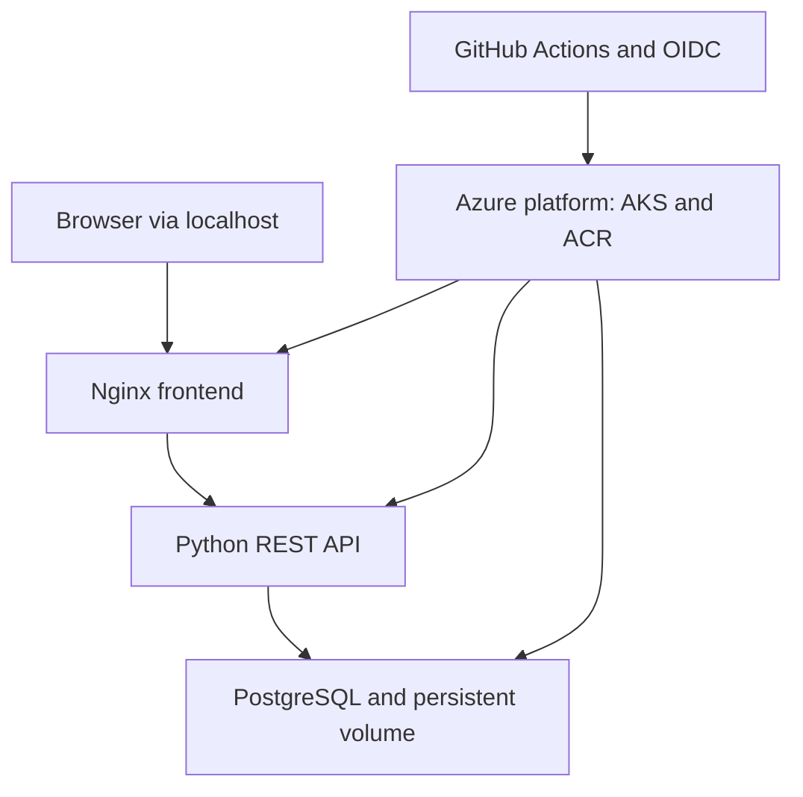

# PlatformOps Board
### Three-tier application and Azure Kubernetes delivery lab

**By Rakesh Goriga · Platform / DevOps Engineering**

A working application codebase designed to demonstrate the path from a source change to a Kubernetes rollout: a browser dashboard, a Python REST API, and PostgreSQL persistence. Terraform defines the Azure platform; GitHub Actions provides tests, infrastructure operations, image delivery, and rollout verification.

**Status:** implementation published; see [verification](docs/verification.md) for executed checks. Cloud deployment is an explicit next step, not a claimed achievement.

[Architecture and tradeoffs](docs/architecture.md) · [Operations runbook](docs/runbook.md) · [Demo walkthrough](docs/demo.md)

## Architecture



## What this demonstrates

| Area | Implementation |
| --- | --- |
| Application | Create/list/update operational tasks; input validation and parameterized SQL |
| Three tiers | Nginx/JavaScript → Python HTTP API → PostgreSQL |
| Infrastructure | AKS, ACR, Log Analytics, and scoped role assignments in Terraform |
| Delivery | GitHub Actions, Azure OIDC, source-SHA image tags, saved Terraform plans |
| Kubernetes | Deployments, StatefulSet, PVC, HPA, API disruption budget, health probes |
| Security | Non-root app containers, restricted pod policy, dropped capabilities, network policies, no public app endpoint |
| Operations | Liveness separate from database readiness, Prometheus-format metrics, JSON logs, rollout checks |
| Verification | SQLite-backed contract tests locally; PostgreSQL/container/schema/Terraform checks configured in CI |

## Run the complete application locally

Prerequisites: Git, Docker Engine/Desktop with Compose v2, Python 3.12+, and OpenSSL.

```bash
git clone https://github.com/rockygorge/RockyProject.git
cd RockyProject/three-tier-platform
export POSTGRES_PASSWORD="$(openssl rand -hex 24)"
docker compose up --build --wait --wait-timeout 180
python3 scripts/smoke.py
```

Open **http://localhost:8080**. Create a task and move it from open to in progress to done.

Stop while retaining data:

```bash
docker compose down
```

Remove the lab data deliberately:

```bash
docker compose down --volumes
```

Keep the same password when reusing the volume. Changing POSTGRES_PASSWORD does not rotate an existing PostgreSQL user's password. This app has no authentication and should remain bound to localhost or accessed through authenticated Kubernetes port-forwarding.

## Run application tests without Docker

The API uses standard-library HTTP and unittest. SQLite is the test adapter; deployments use PostgreSQL.

```bash
cd three-tier-platform/api
python3 -m unittest -v test_app.py
```

For the PostgreSQL contract suite, install api/requirements.txt and set TEST_DATABASE_URL to a disposable PostgreSQL database before running the same tests. The tests create records; do not target a production database.

## Azure setup

AKS nodes, disks, network egress, ACR, and log ingestion incur charges. The repository does not deploy Azure resources automatically on push.

1. Use a personal Azure subscription and an existing Azure Storage backend with a private tfstate container. Bootstrap identity/state outside this Terraform stack.
2. Create a GitHub environment named **platformops-dev**, restrict it to main, and configure required reviewers if your plan supports them.
3. Create an Entra application/service principal and an OIDC federated credential with issuer https://token.actions.githubusercontent.com, audience api://AzureADTokenExchange, and subject **repo:rockygorge/RockyProject:environment:platformops-dev**. For your own fork, replace owner/repository.
4. Give the infrastructure identity Contributor and User Access Administrator at an appropriately scoped lab subscription/resource boundary, and Storage Blob Data Contributor on the state backend. This example creates a resource group, so resource-group-only Contributor on a nonexistent group is insufficient.
5. Configure environment variables:

| Variable | Meaning |
| --- | --- |
| AZURE_CLIENT_ID | OIDC application client ID |
| AZURE_TENANT_ID | Entra tenant ID |
| AZURE_SUBSCRIPTION_ID | Personal Azure subscription |
| TF_STATE_STORAGE_ACCOUNT | Existing backend account |
| PLATFORM_PREFIX | Globally unique 3–12 lowercase letters/digits, starting with a letter |
| DEPLOYER_OBJECT_ID | Service principal object ID, not client ID |
| AZURE_LOCATION | Optional, defaults to eastus2 |

Run **PlatformOps Azure infrastructure → plan** and inspect the output. A separate apply run generates its own plan, then applies that plan. This lab does not provide a separate post-plan approval gate.

6. After an approved apply, use Terraform outputs to set **REGISTRY_NAME**, **REGISTRY_SERVER**, **RESOURCE_GROUP**, and **CLUSTER_NAME** in the same environment.
7. Add **POSTGRES_PASSWORD** as an environment secret: 24+ random alphanumeric characters. Do not commit it.
8. Confirm **PlatformOps CI** passed for the release commit. Run **PlatformOps application release** on main.
9. For local kubectl access, grant your own Entra user the cluster user and appropriate AKS RBAC roles as well. The Terraform role assignments only grant access to DEPLOYER_OBJECT_ID.
10. Authenticate with az login, fetch the AKS kubeconfig, use kubelogin with azurecli, then run:

```bash
kubectl -n platformops port-forward svc/web 8080:8080
```

The example assigns the deployer cluster-admin rights to create namespace-wide controls. For a shared platform, split infrastructure and application identities and narrow application deployment permissions.

## Repository layout

- api/ — HTTP service, database adapter, image, and contract tests.
- web/ — accessible browser UI and same-origin Nginx proxy.
- infra/ — Azure resources and deployment identity role assignments.
- k8s/ — application topology, storage, probes, scaling, and network policy.
- scripts/ — repeatable deployment and end-to-end smoke test.
- docs/ — decisions, operating procedures, evidence, and demonstration.
- ../.github/workflows/ — CI and manually dispatched Azure workflows (repository root).

## Intentional limits

This is a portfolio lab, not a production SaaS claim. PostgreSQL is single-instance; no backups/PITR, user authentication, ingress/TLS, managed database, service mesh, custom Kubernetes operator, or GitOps controller is implemented. Image tags use source SHAs but registry immutability and digest pinning are not enforced. Actions and base images use version tags; a reviewed lock/pinning and vulnerability-scanning process is future hardening.

The API uses a thread-per-request server and per-request database connections. It is suitable for this bounded demonstration, not evidence of high-throughput or production-scale performance. Startup schema creation is a lab convenience, not a migration system.

## Next extensions

- Managed PostgreSQL with tested backup/restore and private access.
- Entra-based application authentication, ingress TLS, and rate limiting.
- Argo CD reconciliation and environment promotion.
- Prometheus/Grafana deployment and SLO dashboards.
- Dependency/image digest pinning and vulnerability scans.
- Multi-environment modules and a separate approval after infrastructure plan.

[Back to Rakesh's portfolio](../README.md)
